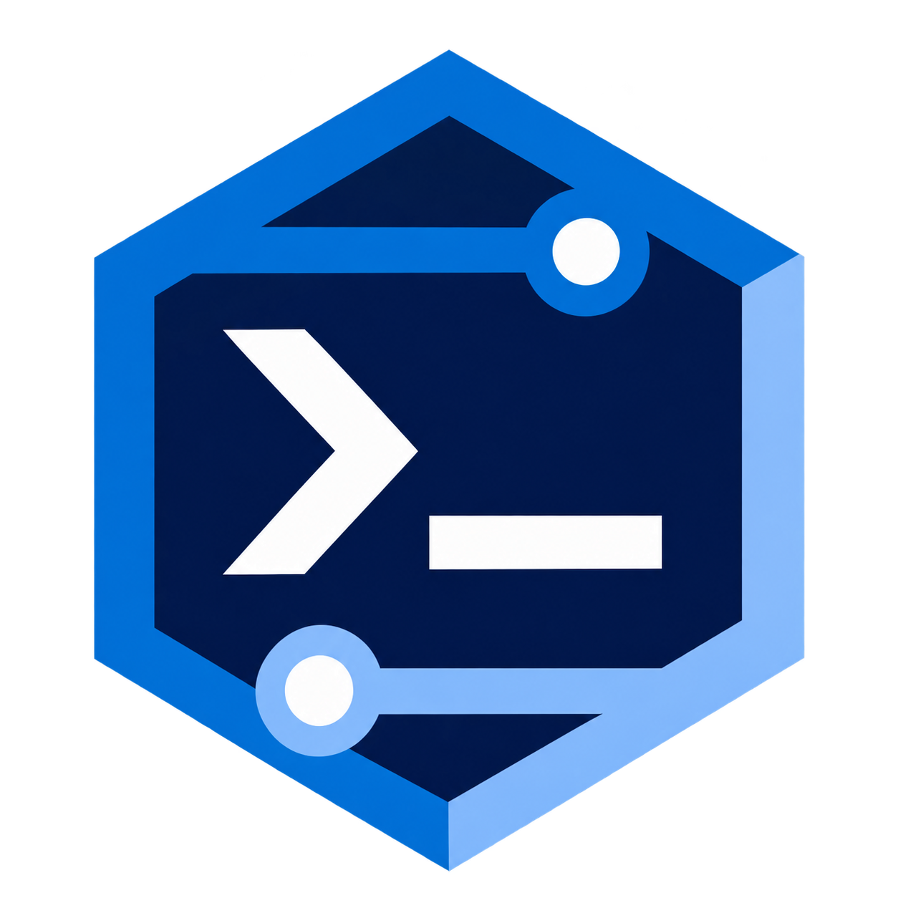

<div align="center">



# AI Sysadmin Agent

**Tus conexiones, tu terminal y tu acompañante IA en un solo lugar.**

Administración de equipos por SSH y RDP para Windows. Gratis y con código propio bajo Apache 2.0.

[](LICENSE)
[](https://github.com/deimisq/AI-Sysadmin/releases/latest)
[](https://github.com/deimisq/AI-Sysadmin/actions/workflows/windows-package.yml?query=branch%3Atesting)
[](https://github.com/sponsors/deimisq)


[Descargas](https://github.com/deimisq/AI-Sysadmin/releases/latest) · [Documentación](#documentación) · [Contribuir](CONTRIBUTING.md) · [Apoyar el proyecto](https://github.com/sponsors/deimisq) · [Sentra IT](https://sentrait.com.uy/)

</div>

## Qué podés hacer

Organizá equipos, abrí sesiones remotas y consultá la IA sin salir del espacio de trabajo. Las conexiones locales no requieren una cuenta ni un backend; cada proveedor de IA conserva sus condiciones y costos.

## Aplicación Windows

El cliente vigente usa .NET 10, WPF, WebView2 y React/TypeScript. Las conexiones locales no requieren una cuenta ni un backend. Los datos se protegen con DPAPI para la cuenta de Windows.

- Inventario de equipos y carpetas, conexiones SSH y escritorio remoto RDP.
- Transferencias SFTP desde el equipo del técnico.
- IA con proveedores de nube o servidores locales Ollama/OpenCode. Los modelos se consultan al proveedor configurado.
- Chat con contexto de la terminal SSH y autorización de comandos por operación, sesión o destino.
- En RDP, asesoramiento con texto o una captura revisada y autorizada para cada consulta. No hay vigilancia continua ni control del escritorio por la IA.
- Exportación e importación de conexiones mediante copia cifrada con contraseña. No incluye claves de IA, tokens GitHub ni conversaciones.
- Actualización integrada con aprobaciones separadas para descargar, instalar y reiniciar la app.

La línea Windows es **0.11.N**: CI asigna N según el número de ejecución. El commit se muestra por separado en Ayuda. Los componentes heredados tienen versiones independientes.

## Instalación y actualizaciones

Los instaladores x64, el ZIP portable y los hashes se generan en [GitHub Actions](https://github.com/deimisq/AI-Sysadmin/actions/workflows/windows-package.yml) y se publican en [Releases](https://github.com/deimisq/AI-Sysadmin/releases). Mientras el repositorio sea privado requieren acceso autorizado.

Requiere Windows x64 compatible con el instalador y Microsoft Edge WebView2 Runtime Evergreen. El paquete incluye .NET; no requiere Python, Node.js ni Docker para usar el cliente Windows.

El instalador ofrece español e inglés y guarda la elección para la app. Los nombres de equipos, comandos, salidas de terminal y conversaciones conservan su contenido original. La documentación propia se mantiene en español; las licencias oficiales y avisos de terceros se conservan sin alterar.

Las compilaciones actuales no tienen firma de código. SHA256 comprueba correspondencia con el archivo publicado por GitHub; no sustituye una firma del editor. No se promete ausencia absoluta de vulnerabilidades.

Consulta [distribución Windows](docs/WINDOWS_DISTRIBUTION.md), [actualizaciones](docs/WINDOWS_UPDATES.md) y [notas de la línea 0.11](docs/releases/WINDOWS_0.11.md).

Los badges de versión y compilación consultan GitHub; su disponibilidad externa depende de la visibilidad del repositorio. El estado de compilación refleja el workflow real, sin indicar manualmente que está aprobado.

## Documentación

| Recurso | Contenido |
|---|---|
| [Instalación y distribución](docs/WINDOWS_DISTRIBUTION.md) | Instalador, ZIP portable, requisitos y validación |
| [Actualizaciones](docs/WINDOWS_UPDATES.md) | Versionado, descarga y aplicación de nuevas versiones |
| [Notas de versión](docs/releases/WINDOWS_0.11.md) | Funcionalidades y cambios de la línea Windows vigente |
| [Arquitectura vigente](docs/IMPLEMENTACION_V3.md) | Componentes y alcance del cliente actual |
| [Contribuciones](CONTRIBUTING.md) | Cómo colaborar y verificar cambios |
| [Seguridad](SECURITY.md) | Cómo comunicar vulnerabilidades de forma privada |

## Desarrollo y pruebas

Usar el SDK de [global.json](global.json) y Node.js 22. Desde la raíz:

```powershell
cd frontend-desktop-ui
npm ci
npm test
npm run build
cd ..
dotnet test apps/windows.Tests/AiSysadmin.Tests.csproj
```

Las integraciones SSH/SFTP usan un laboratorio sintético local y requieren AI_AGENT_SSH_LAB_PYTHON con asyncssh. Las pruebas DPAPI requieren un perfil Windows válido. No usar equipos reales como datos de prueba.

Consulta [AGENTS.md](AGENTS.md), [contribuciones](CONTRIBUTING.md) y [seguridad](SECURITY.md).

## Estructura

| Carpeta | Contenido |
|---|---|
| [apps/windows](apps/windows) | Cliente Windows vigente |
| [apps/windows.Tests](apps/windows.Tests) | Pruebas Windows |
| [frontend-desktop-ui](frontend-desktop-ui) | Interfaz Windows |
| [scripts](scripts) | Compilación y validación |
| [docs](docs) | Documentación y notas de versión |
| [backend](backend) | Backend de empresa, independiente del modo local |
| [frontend-web](frontend-web) | Interfaz web con distribución independiente |
| [legacy-tauri-desktop](legacy-tauri-desktop) | Implementación anterior, fuera del instalador Windows vigente |

Las guías antiguas documentan otras etapas; no certifican funciones del cliente actual. Consulta la [implementación vigente](docs/IMPLEMENTACION_V3.md) y la [revisión de publicación](docs/OPEN_SOURCE_REVIEW.md).

## Licencia y apoyo

Código original bajo [Apache License 2.0](LICENSE), conservando los derechos de terceros: [NOTICE](NOTICE) y [avisos](THIRD_PARTY_NOTICES.md). La licencia no concede derechos sobre marcas ni vuelve gratuitos los servicios externos de IA.

Podés apoyar el mantenimiento mediante [GitHub Sponsors de @deimisq](https://github.com/sponsors/deimisq). Los aportes son voluntarios: usar la app y recibir actualizaciones no requiere donar. El aporte se gestiona en GitHub; la app no solicita datos de pago.

[](https://github.com/sponsors/deimisq)

Desarrollado y mantenido con [Sentra IT](https://sentrait.com.uy/). También podés colaborar reportando problemas con datos sintéticos, mejorando la documentación o proponiendo cambios.
